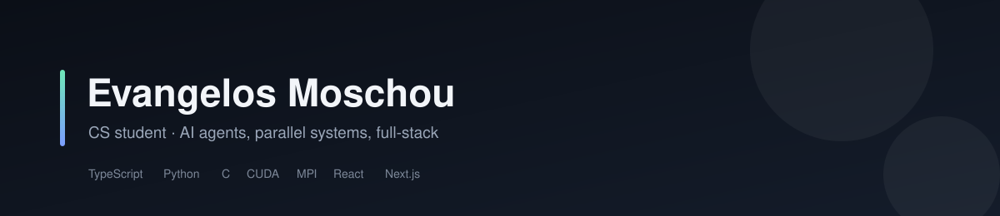

<picture>
  <source media="(prefers-color-scheme: dark)" srcset="assets/banner-dark.svg">
  <source media="(prefers-color-scheme: light)" srcset="assets/banner-light.svg">
  
</picture>

CS student at Aristotle University of Thessaloniki. I build AI agent tooling,
parallel systems, and full-stack applications.

**Live demos:** [CookBook](https://evangelosmoschou.github.io/CookBook/) ·
[NexusFit](https://evangelosmoschou.github.io/NexusFit/)

## What I've built

**AI agents**

- 🔁 **[contributor-sandbox](https://github.com/EvangelosMoschou/contributor-sandbox)** —
  delegation pipeline for cheap coding models: measured a 15M-token exploration cost in a
  real run, designed the prompt/sandbox process that removes it, and shipped the safety
  checklist + cost-analysis tooling.
- 🌉 **[dsh-agent-bridge](https://github.com/EvangelosMoschou/dsh-agent-bridge)** —
  run a coding agent as a tool-callable subagent over the Agent Client Protocol, with a
  deterministic verification gate that stamps unverified output instead of trusting it.

**Full-stack & frontend**

- 🏋️ **[NexusFit](https://github.com/EvangelosMoschou/NexusFit)** —
  my own gym-platform product in Next.js 15 / React 19: marketing site, member portal,
  admin CMS and an AI workout copilot. Multi-tenant over SQLite with offline/PWA mode, rate
  limiting and signed sessions; one config object drives the whole deployment, with Docker
  + Caddy and 9 Vitest suites. AGPL-3.0. **[Try the demo →](https://evangelosmoschou.github.io/NexusFit/)**
- 🍳 **[CookBook](https://github.com/EvangelosMoschou/CookBook)** —
  recipe + culinary-jobs platform: React 18 / TypeScript / Vite 6 front end over an
  Express 5 + SQLite API, responsive from 375 px phones to desktop. The UI doubles as a
  **spec-conformance harness** — every Gherkin acceptance scenario from the SRS can be
  driven into its exact state live. **[Try the demo →](https://evangelosmoschou.github.io/CookBook/)**

**Systems & performance**

- ⚡ **[cuda-bfs-afforest](https://github.com/EvangelosMoschou/cuda-bfs-afforest)** —
  parallel BFS & Afforest connected components in CUDA: direction-optimizing traversal,
  delta-varint compression, 3.6B-edge Friendster graph runs.
- 🧵 **[mpi-opencilk-connected-components](https://github.com/EvangelosMoschou/mpi-opencilk-connected-components)** —
  hybrid distributed/shared-memory connected components: MPI across nodes, OpenCilk within
  each process, built with PGO and LTO.
- 📡 **[bluesky-firehose-collector](https://github.com/EvangelosMoschou/bluesky-firehose-collector)** —
  multithreaded real-time collector in C for the Bluesky Jetstream firehose on a Raspberry
  Pi Zero W (ARMv6). 86,394 of 86,400 one-second samples, p99 deadline jitter 845 µs,
  **zero dropped frames** across 3.4M messages — plus the analysis and the report.
- 📶 **[satellite-receiver-sim](https://github.com/EvangelosMoschou/satellite-receiver-sim)** —
  20 GHz DVB-S2X 64-APSK receiver simulator: RF front-end cascade analysis, ITU-R
  propagation models and dual-path stage-by-stage simulation in C, against a MATLAB reference.

**Applied ML**

- 📈 **[drl-trading-agents](https://github.com/EvangelosMoschou/drl-trading-agents)** —
  deep RL trading agents on Gymnasium/gym-anytrading (A2C baseline, modular pipeline).
- 🧠 **[cifar10-conv-autoencoder](https://github.com/EvangelosMoschou/cifar10-conv-autoencoder)** —
  ResNet-style convolutional autoencoder for CIFAR-10 with masked learning and a joint
  MSE+SSIM loss.

## Now

- Building: a Kubernetes/Docker platform project — containerized ML inference served on a
  cluster with CI/CD, GitOps, and autoscaling.
- Open for entry-level roles where agents do the work and I make them reliable.
